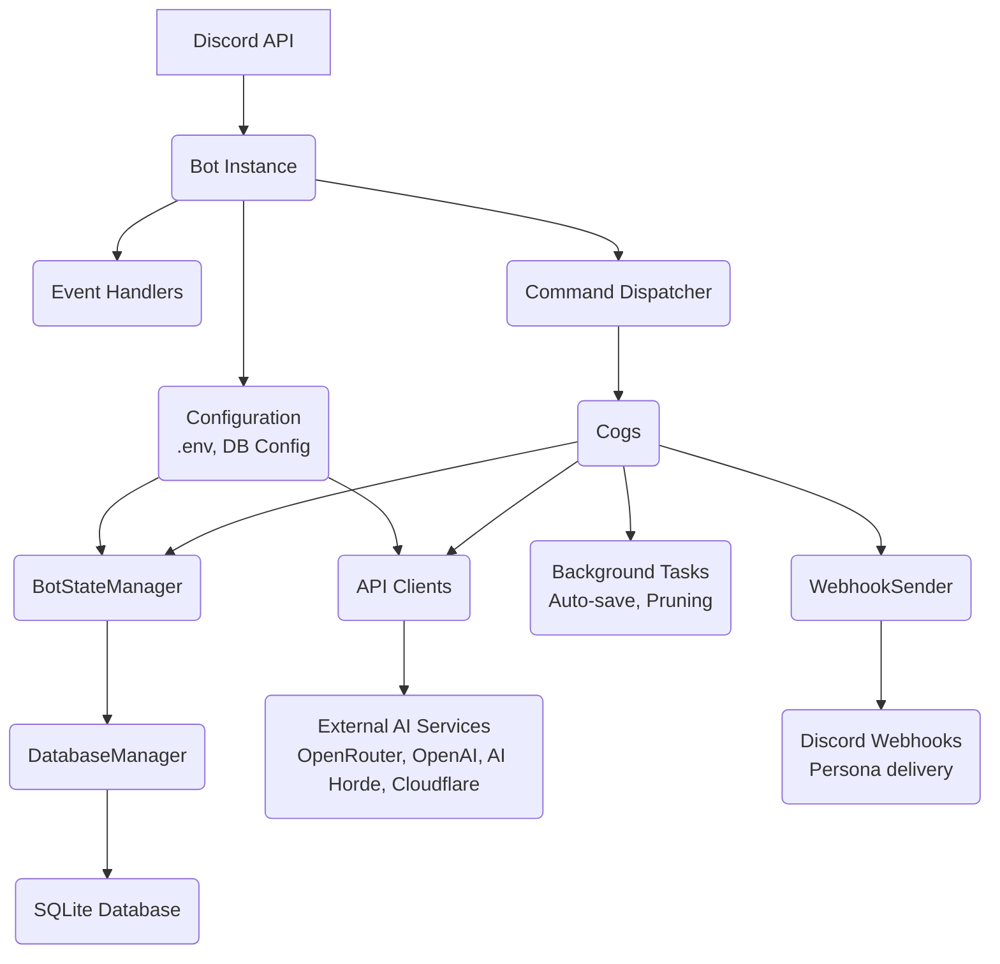

# Gideon - AI Assistant for Discord

## Project Overview

Gideon is a sophisticated Discord bot that serves as an AI-powered assistant, providing intelligent conversations, image generation, video generation, trivia games, reminders, per-channel personas, and more. The bot integrates with multiple AI providers (OpenRouter — which also reaches Anthropic Claude, Google Gemini and others — OpenAI, and AI Horde), image generation services (AI Horde, Cloudflare Workers, DALL-E, ComfyUI, OpenRouter), and video generation via OpenRouter (Veo 3.1, Sora 2 Pro, Seedance, Wan, Kling, etc.).

**Tech Stack:**
- Python 3.10+ (Docker image and CI use 3.12)
- Discord.py (Py-cord 2.4+)
- SQLite database
- Multiple AI provider APIs
- Docker support for deployment

## Architecture

### Architecture Diagram



### Core Components

#### 1. Bot Initialization (`src/bot.py`)
- Initializes Discord bot with proper intents (message content enabled)
- Sets up multiple AI provider clients (OpenRouter, OpenAI, AI Horde)
- Creates `ProviderManager` to handle switching between providers
- Initializes `BotStateManager` for centralized state/config management
- Initializes `WebhookSender` for persona delivery
- Seeds built-in persona templates on startup
- Loads cogs (command modules) dynamically
- Manages graceful shutdown with signal handlers

#### 2. Configuration (`src/config.py`)
Environment-based configuration loading:
- `DISCORD_TOKEN` - Discord bot authentication
- `OPENROUTER_API_KEY` - Primary AI provider
- `OPENAI_API_KEY` - Optional OpenAI/DALL-E access
- `AI_HORDE_API_KEY` - Optional AI Horde image generation
- `CLOUDFLARE_WORKER_URL` & `CLOUDFLARE_API_KEY` - Optional Cloudflare image gen
- `COMFYUI_URL` - Optional local ComfyUI server
- `SYSTEM_PROMPT` - Default AI personality
- `DEFAULT_MODEL` - Initial model (format: `provider/model-name`)
- `DATA_DIRECTORY` - Database and data storage location
- `TOOL_CALLING_ENABLED` - Enable/disable native LLM tool calling (default TRUE; seeds the DB on first start, after which the dashboard/`/settings tools` value wins)
- `TOOL_CALLING_MAX_ITERATIONS` - Max tool-call round-trips before forcing text response
- `INTENT_DISCOVERY` - (Deprecated) Backward compat alias for `TOOL_CALLING_ENABLED`
- `INTENT_DETECTION_MODEL` - (Deprecated) No longer used by tool-calling system
- `INTENT_CONFIDENCE_THRESHOLD` - (Deprecated) No longer used by tool-calling system
- `ENCRYPTION_MASTER_KEY` - Master key for Fernet encryption of API keys stored in DB
- `DASHBOARD_ENABLED` - Enable/disable web admin dashboard
- `DASHBOARD_PORT` - Dashboard server port (default: 8080)
- `DASHBOARD_SECRET` - Authentication secret for dashboard access

#### 3. State Management (`src/utils/state_manager.py`)
`BotStateManager` is the centralized hub for:
- Global configuration (model, provider, system prompt, memory limits)
- Channel-specific overrides (per-channel models/prompts)
- Thread-specific settings
- Persona lookups (`get_effective_persona()`)
- Database connection management
- Active conversation state tracking
- Model provider management

**Key Methods:**
- `get_global_model()`, `set_global_model()`
- `get_channel_config()`, `set_channel_config()`
- `get_thread_config()`, `set_thread_config()`
- `get_active_provider()` - Returns current AI provider client
- `get_effective_persona(channel_id)` - Returns active persona for a channel or None
- `get_effective_model(channel_id)` - Returns model, respecting persona model overrides
- `get_effective_system_prompt(channel_id, query, speaker_id, history, base_prompt, location_id)` - Returns resolved system prompt. Stable part: base prompt, multi-user framing, recent channel summaries. Then `PROMPT_CACHE_BREAK` and the per-message part: a `--- Context ---` block (date/time, server, channel or thread `location_id`, topic, persona name), FTS-matched older summaries and, when `speaker_id` is given, a `--- People in this channel ---` block (speaker's notes in full, short notes for other speakers in `history`). `base_prompt` replaces the persona/channel/global prompt (used for a thread's own prompt)
- `get_effective_session_timeout(channel_id)` - Returns session timeout hours (channel override → global)
- `get_effective_memory_summary_enabled(channel_id)` - Returns bool (channel override → global)
- `get_effective_max_memory_summaries(channel_id)` - Returns summary cap (channel override → global)
- `get_channel_memories(channel_id, limit)` / `add_channel_memory(...)` / `prune_channel_memories(...)` - Memory CRUD delegation
- `get_full_channel_history(channel_id, until)` - Every stored message, ignoring the history window (used when archiving to memory)
- `delete_channel_messages_through(channel_id, message_pk, before_timestamp)` - Deletes exactly the rows that were read and summarized
- `prune_old_data(retain_channel_ids, message_cutoff, retain_thread_ids)` - Time-window prune; retained channels/threads keep their messages. Callers should use `memory_service.archive_and_prune()` instead
- `get_memory_scope(channel_id)` - The channel whose per-user memory a conversation belongs to: a thread maps to its parent (via `THREADS`, or the Discord resolver set with `set_channel_resolver(bot.get_channel)`); any other channel is its own scope
- `get_user_notes(channel_id, user_id)` / `get_user_notes_for(channel_id, user_ids)` / `set_user_notes(...)` / `delete_user_notes(...)` / `list_channel_user_notes(...)` / `delete_channel_user_notes(...)` - Per-user notes, always resolved through `get_memory_scope()`
- `delete_user_notes_everywhere(user_id)`, `is_user_memory_opted_out(user_id)`, `set_user_memory_opt_out(user_id, bool)` - Opt-out lives in `USERS.preferences_json` (`memory_opt_out`); opting out also deletes the user's notes everywhere
- `get_effective_user_memory_enabled(channel_id)` - Per-user memory flag (channel override of the scope → global)
- `reinitialize_state()` - Reloads all config from database (called after backup restore)

**Memory Config Keys** (`GLOBAL_CONFIG` table):
- `session_timeout_hours` (int, default 24) — Hours of silence before a channel session is considered expired
- `memory_summary_enabled` (bool, default True) — Whether expired sessions are auto-summarized before clearing
- `max_memory_summaries` (int, default 10) — Maximum number of memory summaries retained per channel
- `user_memory_enabled` (bool, default True) — Whether per-user notes are kept (per-channel override in `CHANNEL_CONFIG.user_memory_enabled`)

**Cost Config Keys** (`GLOBAL_CONFIG` table):
- `utility_model` (string, default unset) — `provider/model` for background work (memory summaries, people notes, reminder time parsing); unset means the channel's own model
- `daily_user_cost_budget` (float USD, default 0 = unlimited) — Per-user daily LLM spend cap, resets at local midnight
- `daily_user_image_limit` (int, default 25) / `daily_user_video_limit` (int, default 3) — Per-user daily generation caps (0 = unlimited)

#### 4. Provider Management (`src/utils/model_manager.py`)
`ProviderManager` lists and caches each provider's models and validates model IDs (`parse_model_id`, `get_models`). It does not route requests or fall back between providers — `ConversationService.resolve()` picks the client for a conversation.

#### 5. Reply Pipeline (`src/utils/conversation_service.py`)
`ConversationService` (on `bot.conversation_service`) is the single path for answering a turn, shared by @mentions, `/chat`, `/thread new|message` and the thread auto-reply:
- `Conversation(channel, channel_id, thread_id=None)` — where history lives (`channel_id` is always the config/persona/memory scope; for threads it's the parent)
- `ReplyRequest(conversation, author, content, message, attachments, history_until, recorded, feature)` — one turn; `message` is the `discord.Message` (or a `MessageLike` built from a slash-command ctx) tool handlers post through
- `respond(request)` resolves provider/model/client (persona > thread > channel > global, always passing `model=` explicitly — never mutate a shared `client.model`), checks the user's daily budget, loads anchored history, builds the system prompt, collects images, runs the tool loop (or a plain call), records and sends the reply via the persona webhook when active
- `record_user_turn()` records a human turn with session rotation and compaction for channels

#### 6. LLM Results & Usage (`src/utils/llm_result.py`, `src/utils/usage.py`, `src/utils/budget.py`)
- Clients expose `chat(...) -> ChatResult` (`content`, `tool_calls`, `usage`, user-facing `error`, `error_kind`, raw `detail` for logs only). `send_message_with_history()` keeps its legacy str/dict/"⚠️ ..." shape for older callers; `call_chat(client, ...)` adapts any client to `ChatResult`
- OpenRouter retries rate limits, timeouts, network errors and 5xx with jittered backoff (honours `Retry-After`); the OpenAI SDK does its own retries
- Wrap work in `usage_scope(feature, user_id=..., channel_id=...)`; clients call `record_usage(result)` and the sink registered at startup writes a `USAGE` row. Background memory work clears the user (`user_id=None`)
- `budget.chat_budget_error()` / `generation_limit_error()` / `record_generation()` enforce per-user daily limits (admins and the owner are exempt)

### Database Layer (`src/utils/database/`)

The database is modular, with separate managers for each domain:

#### Schema (`schema.py`)
Core tables:
- `GLOBAL_CONFIG` - Bot-wide settings (key-value store with type safety)
- `CHANNELS` - Discord channel metadata
- `CHANNEL_CONFIG` - Channel-specific AI overrides (model, provider, system prompt)
- `THREADS` - AI conversation threads (Discord native threads)
- `MESSAGES` - Conversation history (channel_id, thread_id, role, content, timestamp)
- `USERS` - User preferences (JSON storage)
- `REMINDERS` - Scheduled notifications (user, channel, due_timestamp, sent status)
- `TRIVIA_GAME_SESSIONS` - Active/historical trivia games
- `TRIVIA_LEADERBOARD` - Per-server user statistics (total games, points, streaks)
- `TRIVIA_ACHIEVEMENTS` - Unlockable badges (JSON metadata)
- `API_KEYS` - Encrypted API key storage (provider, encrypted_key, alias, validation_status, timestamps)
- `API_KEY_AUDIT` - Audit log for all key operations
- `PERSONA_TEMPLATES` - Built-in and custom persona templates (name, display_name, avatar_url, system_prompt, model, is_builtin)
- `CHANNEL_PERSONAS` - Per-channel persona configuration (display_name, avatar_url, system_prompt, model_override, webhook_id, webhook_token, is_active)
- `CHANNEL_MEMORY` - Long-term per-channel memory summaries (channel_id, summary, message_count, conversation_start, created_at); not pruned by the time-window prune — persists until `max_memory_summaries` cap or manual deletion
- `CHANNEL_USER_MEMORY` - Per-user notes scoped to one channel; `PRIMARY KEY (channel_id, user_id)` (notes as a bullet list, display_name, message_count, created_at, updated_at). A user's notes in one channel are never read for another. Excluded from config JSON exports
- `MESSAGES.is_bot` - Set for messages from bots/webhooks, which never get per-user notes
- `THREADS.creator_id` - User who ran `/thread new` (may manage the thread without Manage Threads)
- `USAGE` - One row per LLM call (tokens, cached tokens, cost) or image/video job (`units=1`), with feature, user, channel, provider, model

**Migrations** are versioned with `PRAGMA user_version` (`SchemaManager.MIGRATIONS`); each runs once, in order. Foreign keys are declared but not enforced, so deletes clean up child rows explicitly (e.g. `delete_thread` removes the thread's messages). The connection is wrapped in `LockedConnection` so bot and dashboard threads never interleave transactions.

#### Database Managers
- `core.py` - `DatabaseManager` orchestrator; delegates to all sub-managers
- `config_manager.py` - Global config CRUD
- `channel_manager.py` - Channel config CRUD
- `thread_manager.py` - Thread config CRUD
- `message_manager.py` - Message history CRUD (supports filtering by time window)
- `user_manager.py` - User preferences
- `reminder_manager.py` - Reminder scheduling and retrieval
- `trivia_manager.py` - Trivia game state persistence
- `api_key_manager.py` - Encrypted API key CRUD and audit logging
- `persona_manager.py` - Persona template and channel persona CRUD
- `backup_manager.py` - Config JSON export/import/validation and SQLite backup/restore
- `memory_manager.py` - Long-term channel memory CRUD (`get_memories`, `add_memory`, `delete_memories`, `prune_memories`, `get_all_memory_stats`)
- `usage_manager.py` - Usage rows and summaries (`db.usage`)
- `user_memory_manager.py` - Per-user, per-channel notes (`db.user_memory`). Every read/write requires both `channel_id` and `user_id` (raises `ValueError` otherwise); only deletes take a bare `user_id`

### Command Modules (`src/cogs/`)

Each cog is a self-contained feature module loaded dynamically at startup:

1. **`admin_commands.py`** - Admin/owner-only tools
   - `/admin sync`, `/admin debug`, `/admin state`, `/admin diagnostic` (connectivity, DNS, models), `/admin vision_models`, `/admin prune`

2. **`chat_commands.py`** - Core AI conversation features
   - `/chat`, `/reset`, `/summarize`
   - `/memory status` (channel memory status), `/memory me` (your notes here, ephemeral), `/memory forget [this channel|everywhere]`, `/memory optout`, `/memory optin`, `/memory forget_user` (admin, this channel)
   - Checks for active persona per channel and routes responses through `WebhookSender`

3. **`mention_commands.py`** - Handles @mentions of the bot
   - `@everyone` / `@here` count as mentioning Gideon (only when Discord actually pinged everyone, i.e. the author had permission) unless an admin turned that off: `respond_to_everyone` in `GLOBAL_CONFIG` (default True) with a per-channel override `CHANNEL_CONFIG.respond_to_everyone` (NULL = inherit; threads follow their parent), set from the dashboard Settings and channel editor
   - Replying to one of Gideon's messages counts as addressing it, even with the reply ping off
   - Also answers @mentions in user-created threads and forum posts (AI threads and trivia threads stay with their own cogs); those conversations keep their own thread history and share the parent channel's memory and settings
   - Messages are stored via `llm_formatting.describe_message()`: readable mentions plus what they reply to, forwarded snapshots, attachment names, embeds and stickers
   - Replies are Discord replies to the triggering message (bot account; persona webhooks can't reply)
   - Uses native LLM tool calling (when `TOOL_CALLING_ENABLED=TRUE`)
   - The primary model receives tool definitions and decides natively whether to call a tool (reminder, image generation, calculation, translation, etc.) or respond conversationally
   - Eliminates the need for a separate intent classification LLM call
   - Tool definitions are managed in `src/utils/tool_registry.py`
   - Maintains conversation context across mentions
   - Supports image analysis via attachments

4. **`settings_commands.py`** - Global bot configuration (Admin)
   - `/settings show`, `/settings model`, `/settings system`, `/settings provider`
   - `/settings memory`, `/settings window`, `/settings restore`
   - Hidden from Discord when dashboard is enabled

5. **`channel_commands.py`** - Channel-specific overrides (Admin)
   - `/channel show`, `/channel model`, `/channel system`, `/channel provider`, `/channel reset`, `/channel list`
   - Hidden from Discord when dashboard is enabled

6. **`thread_commands.py`** - AI conversation threads
   - `/thread new`, `/thread message`, `/thread list`, `/thread show`
   - `/thread model`, `/thread system`, `/thread rename`, `/thread delete`
   - Auto-responds to all messages in AI threads
   - Routes responses through `WebhookSender` if channel has active persona

7. **`trivia_commands.py`** - AI-powered trivia game system
   - `/trivia start`, `/trivia stop`, `/trivia stats`, `/trivia leaderboard`, `/trivia achievements`

8. **`unified_image_commands.py`** - Unified image generation
   - `/dream` - Generate images (routes to active provider)
   - `/dream_manage set_provider`, `/dream_manage view_config`, `/dream_manage configure`, `/dream_manage comfyui_*`

9. **`video_commands.py`** - AI video generation via OpenRouter
   - `/video` - Generate a video from a text prompt; per-invocation overrides for `model` (autocompleted), `duration`, `aspect_ratio`, `resolution` (480p, 720p, 1080p, 2K, or 4K), `audio`, `seed`, and `image_url` (image-to-video)
   - Model autocomplete reads the client's cached live list; a stale cache refreshes in the background and the first lookup waits at most 2s (Discord's autocomplete deadline is 3s)
   - `/video_manage view_config`, `/video_manage models`, `/video_manage configure` (Admin; hidden when dashboard is enabled)
   - Submits to OpenRouter's async `/api/v1/videos` API, polls every 15s with status updates, then attaches the result (≤25 MB) or links the unsigned URL
   - Persists results as `[video:url]` markers in message history for dashboard playback

10. **`reminder_commands.py`** - Scheduled notifications
   - `/remind`, `/listreminders`, `/cancelreminder`
   - Background task checks for due reminders every 60s

11. **`dashboard_commands.py`** - Web admin dashboard management
    - `/dashboard status`, `/dashboard restart`

12. **`persona_commands.py`** - Per-channel persona management (Admin)
    - `/persona set` - Set custom persona (display_name, avatar_url, system_prompt, model_override)
    - `/persona template` - Apply a built-in or custom template to this channel
    - `/persona show` - View current channel persona
    - `/persona list` - List all channels with configured personas
    - `/persona templates` - Browse all available templates
    - `/persona toggle` - Enable or disable persona without removing it
    - `/persona remove` - Remove persona from channel
    - `/persona preview` - Send a test webhook message with current persona

13. **`url_commands.py`** - URL summarization (`/summarize_url`, fetched through `safe_fetch`)

14. **`help_commands.py`** - Interactive `/help`, built from `bot.application_commands` so it always matches the registered commands

### Persona System

#### WebhookSender (`src/utils/webhook_sender.py`)
Manages the full webhook lifecycle for persona delivery:
- **Three-tier webhook lookup**: memory cache → DB credentials → Discord API scan → create new
- **Async locking**: prevents race conditions when multiple messages target the same channel
- **Thread support**: uses parent channel for threads, passing the thread as the `thread` param to Discord's webhook API
- **Fallback**: if webhook creation fails (missing `Manage Webhooks` permission), silently falls back to bot account
- **Cache invalidation**: `invalidate_cache(channel_id)` clears a channel's cached webhook (called after persona toggle/remove)

**Webhook Resolution Flow:**
1. Check `self._webhook_cache[channel_id]`
2. If miss, check DB for stored `webhook_id` / `webhook_token`
3. If no DB credentials, scan channel's existing webhooks for one created by the bot
4. If none found, create a new webhook and persist credentials to DB
5. Return `None` on `discord.Forbidden` → triggers fallback to bot account

#### Persona Templates (`src/utils/persona_templates.py`)
Defines built-in templates seeded on startup:
- Helpful Assistant, Tech Guru, Creative Writer, Study Buddy, Concise Responder

Built-in templates cannot be deleted. Custom templates can be freely created and removed.

#### Chat Integration
Replies go out through `ConversationService.send()`, which calls `bot.webhook_sender.send_response(channel, chunk, channel_id)` — the persona webhook when one is active, the bot account otherwise. New reply paths should build a `ReplyRequest` rather than sending themselves.

### Backup & Restore System

#### BackupManager (`src/utils/database/backup_manager.py`)
Handles all backup and restore operations:

**Config Export (JSON)**
- Exports tables: `GLOBAL_CONFIG`, `CHANNELS`, `CHANNEL_CONFIG`, `PERSONA_TEMPLATES`, `CHANNEL_PERSONAS`, `USERS`
- Excludes: `API_KEYS`, `MESSAGES`, webhook credentials from `CHANNEL_PERSONAS`
- Includes schema version for compatibility validation on import

**Config Import (JSON)**
- Validates export type, version, and schema compatibility before applying
- Uses upsert patterns; preserves existing `webhook_id`/`webhook_token` on channel persona rows
- Wrapped in a database transaction — atomically succeeds or rolls back entirely
- Calls `state_manager.reinitialize_state()` after successful import

**SQLite Backup**
- Uses SQLite's online backup API (`sqlite3.Connection.backup()`) for a consistent snapshot
- Written to system temp directory, served as a file download, then cleaned up

**SQLite Restore**
- Validates magic bytes, expected tables, and row counts before applying
- Replaces current database file, then calls `state_manager.reinitialize_state()`

**File Size Limits** — 10 MB for JSON configs, 100 MB for SQLite backups

### Dashboard (`src/dashboard/`, `src/utils/dashboard/`)

#### Backend (`src/utils/dashboard/server.py`)
aiohttp web server running in the same event loop as the bot:
- Token-based authentication via `src/utils/dashboard/auth.py`
- WebSocket endpoint for real-time activity broadcasts
- REST API endpoints for all management operations

**Backup & Restore API Endpoints:**
- `GET /api/backup/config` — Export config as JSON
- `GET /api/backup/database` — Export full database backup
- `POST /api/backup/config/validate` — Validate JSON config before import
- `POST /api/backup/config/import` — Apply JSON config
- `POST /api/backup/database/validate` — Validate SQLite backup file
- `POST /api/backup/database/restore` — Restore from SQLite backup

**Usage API Endpoint:**
- `GET /api/usage?days=7` — Totals (calls, tokens, cached tokens, cost, generation units) and breakdowns by day, feature, model and user (1–90 days). The settings endpoints also carry `utility_model`, `daily_user_cost_budget`, `daily_user_image_limit`, `daily_user_video_limit`

**Video Generation API Endpoints:**
- `GET /api/video/settings` — Active provider, default config (model, duration, aspect_ratio, resolution, audio), availability flag
- `PUT /api/video/settings` — Update active provider and/or default config
- `GET /api/video/models` — Live model list from OpenRouter (`/api/v1/videos/models`, cached 10 min; `?refresh=1` forces a refetch). Returns an error instead of a hardcoded fallback if OpenRouter is unreachable
- `POST /api/video/generate` — Submit a video generation job (returns `job_id`, `status`, `polling_url`)
- `GET /api/video/jobs/{job_id}` — Poll job status; returns `status` and `unsigned_urls`

**Persona API Endpoints:**
- `GET /api/personas/templates` — List all templates
- `POST /api/personas/templates` — Create custom template
- `PUT /api/personas/templates/{id}` — Update template
- `DELETE /api/personas/templates/{id}` — Delete template (rejects built-ins)
- `GET /api/personas/channels` — List all channel personas
- `POST /api/personas/channels/{channel_id}` — Set channel persona
- `POST /api/personas/channels/{channel_id}/apply-template` — Apply template to channel
- `PATCH /api/personas/channels/{channel_id}/toggle` — Toggle active state
- `DELETE /api/personas/channels/{channel_id}` — Remove channel persona

**Memory API Endpoints:**
- `GET /api/memory` — List all channels with stored memories (channel_id, count, latest summary date)
- `GET /api/memory/{channel_id}` — Get all summaries for a channel (id, summary, message_count, conversation_start, created_at)
- `DELETE /api/memory/{channel_id}` — Clear all memories for a channel
- `POST /api/memory/{channel_id}/summarize` — Manually trigger summarization of current history and clear it
- `GET /api/memory/{channel_id}/users` — Per-user notes kept for a channel (`enabled`, `users[]`)
- `PUT /api/memory/{channel_id}/users/{user_id}` — Replace one user's notes in that channel (`{notes}`; 404 if none exist)
- `DELETE /api/memory/{channel_id}/users/{user_id}` — Delete one user's notes in that channel
- `DELETE /api/memory/{channel_id}/users` — Delete every user's notes in that channel

`GET /api/memory` rows also carry `user_count` (people with notes), and channels that only have people notes are listed too.

The `GET/PUT /api/settings` and `GET/PUT /api/channels/{id}` endpoints also include the memory config fields: `session_timeout_hours`, `memory_summary_enabled`, `max_memory_summaries`, `user_memory_enabled` (per-channel values may be `null` to inherit global). `DELETE /api/channels/{id}` also clears the memory overrides.

#### Frontend (`src/dashboard/`)
Single-page application with tab-based navigation:
- **Overview tab** — Bot status, provider/key health, recent errors, and a Usage card (cost, tokens, cached tokens, generations; by feature, model and person; today / 7 / 30 days)
- **Settings tab** — Global model/prompt, memory, tool calling, and Cost controls (utility model, per-user daily chat budget, image and video limits)
- **Memory tab** — Overview table of all channels with memories (summaries and people counts); channel detail card showing summaries with `conversation_start` dates and message counts, plus a "People in this channel" list where each user's notes can be edited or deleted; Clear, Clear people notes and Trigger Summarize actions per channel
- **Personas tab** — Template card grid, channel personas table, modal editor for create/edit
- **Video Gen tab** — Backend status, model picker with capability hints (resolutions, aspect ratios, durations, audio, image-to-video), defaults form, and a test-generation card that submits a job, polls every 5s, and embeds the resulting `<video>` inline
- **Backup & Restore tab** — Drag-and-drop upload zones, validation preview cards, confirmation modal for database restore

WebSocket events trigger real-time tab refreshes for `template_updated`, `persona_updated`, etc.

## Configuration System

Three-tier configuration system:
- **Static** (`.env`): Used for tokens, `DATA_DIRECTORY`, `ENCRYPTION_MASTER_KEY`, and initial defaults
- **Dynamic** (`GLOBAL_CONFIG` table): Modifiable at runtime via `/settings` commands; persisted in the database across restarts
- **API Keys** (`API_KEYS` table): Fernet-encrypted in the database, managed via the dashboard. DB keys take priority over `.env` values; `.env` is used as fallback

Runtime resolution order (most specific wins):
1. **Persona model override** — If channel has active persona with `model_override`
2. **Thread Settings** (via `/thread`) — Thread-specific configs
3. **Channel Overrides** (via `/channel`) — Per-channel customization
4. **Global Settings** (via `/settings`) — Default for all channels

## Common Workflows

### Adding a New Command
1. Create or edit cog file in `src/cogs/`
2. Define command with `@discord.slash_command()` decorator
3. Access state via `ctx.bot.state_manager`
4. Access AI provider via `ctx.bot.model_manager.get_active_provider()`
5. For persona-aware responses, call `ctx.bot.webhook_sender.send_response()` if persona is active
6. Handle errors gracefully (respond with user-friendly messages)
7. Restart bot or use `/admin sync` to register new command

### Adding a New AI Provider
1. Create client class in `src/utils/` (e.g., `new_provider_client.py`)
2. Implement standard methods: `chat()`, `list_models()`, etc.
3. Add initialization in `src/bot.py`
4. Register with `ProviderManager` in `src/utils/model_manager.py`
5. Update config commands to support new provider
6. Update documentation

### Database Migration
1. Update `src/utils/database/schema.py` with new table/column
2. Add migration logic in `SchemaManager.initialize()` or a separate migration method
3. Create a corresponding manager class if needed
4. Delegate new methods from `core.py` `DatabaseManager`
5. Update `BotStateManager` to expose new data if needed
6. Test migration on clean DB and existing DB

### Adding a Persona Template
Built-in templates are defined in `src/utils/persona_templates.py` and seeded on startup via `db_manager.seed_builtin_persona_templates()`. To add a new built-in:
1. Add entry to the templates list in `persona_templates.py`
2. Restart the bot — seeding is idempotent (uses INSERT OR IGNORE)

## Key Design Decisions

1. **SQLite for Persistence** - Simple, file-based, no external DB server needed
2. **Modular Database Managers** - Each domain has a dedicated manager; `core.py` delegates
3. **Provider Abstraction** - `ProviderManager` allows seamless switching between AI providers
4. **Webhook-First Personas** - Persona delivery via webhooks gives channels a distinct identity; bot account fallback ensures reliability without permissions
5. **Singleton Pattern** - `BotStateManager` and `WebhookSender` are singletons accessed via `bot.state_manager` and `bot.webhook_sender`
6. **Discord Native Threads** - Leverage Discord's built-in threading for organization; personas inherit from parent channels
7. **Environment-Based Config** - `.env` file for secrets and deployment-specific settings
8. **Graceful Degradation** - Missing API keys or permissions disable features but don't crash the bot
9. **Docker-First Deployment** - Dockerfile + docker-compose.yml for easy deployment
10. **Dashboard Opt-In** - Web dashboard disabled by default, runs in same event loop when enabled; hides redundant slash commands when active
11. **Transaction Safety** - Config imports use database transactions to ensure atomicity; partial imports never happen
12. **Backup Security** - API keys and raw webhook tokens are excluded from config exports; webhook credentials are re-applied from DB during import to avoid loss

## Error Handling and Logging

Error handling:
1. **Command-level**: `try/except` blocks in individual command functions catch specific exceptions and return user-friendly messages
2. **Global**: `on_application_command_error` in `bot.py` answers every failed slash command with a short ephemeral message (permission, cooldown, missing Discord permission, or a generic error) and logs the traceback — raw exception text is never shown to users
3. **LLM errors** travel as `ChatResult.error` (friendly text) with the provider's raw response only in `detail`/logs, and are never stored in history

Logging uses Python's standard `logging` module:
- Each module uses `logging.getLogger(__name__)` for its own logger
- Levels: DEBUG, INFO, WARNING, ERROR, CRITICAL
- Tracebacks logged via `logger.exception()` for error diagnosis
- Output to console; Docker users view via `docker-compose logs -f`

## Security

- **API Keys**: Can be stored in `.env` or encrypted in the database via the dashboard. Database keys use Fernet symmetric encryption (`src/utils/encryption.py`) with a master key from `ENCRYPTION_MASTER_KEY`. Keys are decrypted only at runtime when needed. The dashboard API never exposes raw or encrypted keys — only masked values (e.g., `sk-...xyz123`)
- **Key Resolution Priority**: Database keys (encrypted) take precedence over `.env` values
- **Audit Logging**: All API key operations (create, update, delete, validate) are logged in `API_KEY_AUDIT`
- **Webhook Credentials**: `webhook_id` and `webhook_token` are stored in the database but excluded from config JSON exports. They are re-applied automatically during config import to prevent loss of Discord integrations
- **Backup Security**: Config exports exclude API keys entirely, and per-user notes. Full database backups include all data but should be treated as sensitive
- **Per-User Memory Isolation**: Notes are keyed by `(scope channel, user_id)` and only loaded for the channel a conversation happens in. Extraction only labels people who spoke in that channel's transcript and drops any other label the model returns; the `remember_about_me` / `forget_about_me` tools take their key from the message author and channel, never from model arguments. `/thread message` refuses to run outside the thread or its parent channel, since its reply carries the parent's memory. Notes are framed in the prompt as background facts, never instructions
- **Permission Controls**: Enforced via Py-Cord decorators (`@commands.is_owner()`, `@commands.has_permissions(administrator=True)`) and the runtime helpers in `src/utils/permissions.py`: `/reset` and `/setprovider` need Manage Channels; `/thread delete|rename|model|system` need the thread's creator (`THREADS.creator_id`) or Manage Threads, and the thread must belong to the invoking server. The `create_poll` / `schedule_event` tools check the *author's* Send Polls / Create Events permission, since Gideon acts with its own
- **No mass pings**: `SAFE_ALLOWED_MENTIONS` (`src/utils/discord_fmt.py`) is set on the bot and on every webhook send — replies can ping users but never `@everyone`, `@here` or roles
- **Bot loops**: messages from other bots and webhooks are recorded as context but never answered
- **Untrusted URLs**: `/summarize_url` fetches through `src/utils/safe_fetch.py` — http(s) only, a resolver that refuses non-public IPs at connect time (covers redirects and DNS rebinding), a 2 MB body cap. Video downloads only send the OpenRouter key to `openrouter.ai` hosts
- **Calculator**: the `calculate` tool walks a whitelisted `ast` (no `eval`/sympy), with caps on expression length, exponent size and factorials
- **Input Validation**: Command inputs and external API responses are validated to prevent injection or malformed data issues

## Flows Reference

### Persona Response Flow
1. User sends message in a channel or AI thread
2. `chat_commands.py` / `thread_commands.py` checks `state_manager.get_effective_persona(channel_id)`
3. If persona is active, routes to `bot.webhook_sender.send_response(channel, content, channel_id)`
4. `WebhookSender` resolves or creates a webhook for the channel (three-tier lookup)
5. Response is sent via webhook with persona's `display_name` and `avatar_url`
6. If webhook fails, `WebhookSender` falls back to bot account standard send

### Backup Export Flow
1. Admin clicks "Export Config" or "Export Database" in dashboard Backup tab
2. Request hits `GET /api/backup/config` or `GET /api/backup/database`
3. `BackupManager.export_config_json()` or `create_sqlite_backup()` is called
4. File is streamed to client with appropriate `Content-Disposition` header
5. Temp files (for SQLite) are cleaned up after response

### Config Import Flow
1. Admin uploads JSON file to dashboard
2. `POST /api/backup/config/validate` — `BackupManager.validate_config_json()` returns preview
3. Dashboard shows validation preview; admin confirms
4. `POST /api/backup/config/import` — `BackupManager.import_config_json()` runs in a transaction
5. `state_manager.reinitialize_state()` reloads config from DB
6. WebSocket broadcasts `config_imported` event; dashboard refreshes

### Session Rotation & Channel Memory Flow
1. User sends a message to a channel (via `/chat` or @mention)
2. `check_and_rotate_session(channel_id, state, clients)` is called from `memory_service.py` **before** fetching history
3. The timestamp of the most recent stored message is compared to `session_timeout_hours`
4. If the session has expired **and** `memory_summary_enabled` is True **and** history has ≥ 3 messages:
   a. Existing channel memories are fetched and injected as context into the summarization prompt
   b. The LLM generates a 2–3 sentence summary of the old conversation
   c. The summary is stored in `CHANNEL_MEMORY` with the original `conversation_start` timestamp
   d. Memories are pruned to `max_memory_summaries`
5. The summarized rows are deleted (bounded by `message_pk`, so anything recorded mid-summary survives); the new message starts a fresh session
6. On every subsequent LLM call, `get_effective_system_prompt(channel_id)` appends a `--- Channel Memory ---` block listing all stored summaries (oldest → newest), giving the model long-term context without inflating the live message window

**No history is deleted unsummarized.** All paths that remove channel messages go through `memory_service` and hold the per-channel lock:
- **Rotation** (inactivity) and **compaction** (history over `max_channel_history`) read the full stored history, not just the window
- **Time-window prune** — the scheduled task and `/api/diagnostics/prune` call `archive_and_prune()`, which first summarizes each channel's messages older than `time_window_hours`. If a summary fails, that channel's rows are kept and retried on the next prune (or by rotation). With no LLM client configured, or summarization disabled, rows are pruned as before. Thread messages are still pruned without summaries
- **Manual summarize** (`POST /api/memory/{channel_id}/summarize`) uses `summarize_and_clear()`, which keeps the history if summarization fails

### Per-User Memory Flow
Gideon keeps short notes about each person, unique to each channel (a thread shares its parent channel's notes):
1. **Extraction** — whenever history is archived (rotation, compaction, the pre-prune sweep, manual summarize), `memory_service._update_user_notes()` makes one extra LLM call. The transcript labels each human speaker `[P1]`, `[P2]`… (bots and opted-out users get no label), alongside those speakers' current notes for **this scope only**. The model returns `{label: [notes]}`; unknown labels are dropped, notes are capped (`user_memory.MAX_NOTE_BULLETS`), and notes added or cleared while the call was in flight are respected. Thread messages are extracted by the pre-prune sweep into the parent's scope
2. **Failure handling** — a failed call (error reply/exception) makes the prune sweep keep that channel's or thread's messages for retry; a malformed reply is logged and skipped
3. **Injection** — every reply path (mentions, `/chat`, `/search`, web search tool, threads) passes `speaker_id` and the visible `history` to `get_effective_system_prompt()`, which appends the speaker's notes plus up to 4 bullets for up to 4 other recent human speakers
4. **User controls** — `/memory me|forget|optout|optin`, the `remember_about_me` / `forget_about_me` tools, and the dashboard's People list

### Native Tool Calling (@mentions, /chat, threads)
When tool calling is enabled (the default; legacy `INTENT_DISCOVERY=TRUE` also enables it):
1. User @mentions bot: "@Gideon remind me in 2 hours to check logs" (or uses `/chat`, or writes in an AI thread)
2. `ConversationService` sends the message to the **primary LLM model** with tool definitions attached
3. The model decides natively whether to call a tool (`set_reminder`, `generate_image`, `web_search`, `calculate`, `create_poll`, `convert_timezone`, `roll_dice`, `schedule_event`, `remember_about_me`, `forget_about_me`) or respond conversationally. Translation, definitions and unit conversion are answered by the model directly (they used to be tools that only made a second LLM call)
4. If the model requests tool calls, each tool is executed via `tool_registry.execute_tool()` and results are fed back to the model
5. The model generates a final text response incorporating the tool results
6. If tool calling is disabled, falls back to plain conversation (no tools)

**Key advantages over the old intent classification system:**
- Single LLM call instead of two (classification + response)
- No 320-line classification prompt — tool descriptions are compact
- No confidence threshold heuristic — the model decides natively
- Supports multi-tool requests (e.g., "calculate 15% of 250 and remind me about it at 5pm")
- Uses conversation context (the model sees chat history, so "translate that" works)

**Tool definitions** are managed in `src/utils/tool_registry.py`. To add a new tool:
1. Add a tool definition to `TOOL_DEFINITIONS` (OpenAI function schema format)
2. Add an execution function `_execute_new_tool()`
3. Add a dispatch case in `execute_tool()`

### Image Generation Flow
1. User runs `/dream prompt:"sunset over mountains"`
2. Command routes to `unified_image_commands.py`
3. Retrieves active provider from config DB
4. Calls provider-specific client (AI Horde, Cloudflare, OpenAI, ComfyUI, OpenRouter)
5. Bot posts result with embed (includes prompt, model, settings)

### Video Generation Flow
1. User runs `/video prompt:"a cat surfing a wave"` (with optional `model`, `duration`, `aspect_ratio`, `resolution`, `audio`, `seed`, `image_url` overrides)
2. `video_commands.py` merges overrides over the saved defaults from `video_config_openrouter` in `GLOBAL_CONFIG`
3. `OpenRouterVideoClient.submit_video()` POSTs to `/api/v1/videos` and returns a `job_id`
4. The cog calls `wait_for_completion(job_id)` which polls `/api/v1/videos/{id}` every 15s, editing the original Discord message with each new status (uses an `on_status` callback to throttle edits)
5. On terminal status `completed`, the bot downloads the first URL from `unsigned_urls` and either attaches the MP4 (≤25 MB) or posts the URL in an embed
6. A `[video:url]` marker is persisted to `MESSAGES` for dashboard playback
7. Dashboard test generation uses `POST /api/video/generate` followed by client-side polling of `GET /api/video/jobs/{id}` every 5s

**Database Keys:**
- `video_active_provider` (string) — `"openrouter"` (only provider currently)
- `video_config_openrouter` (json) — `{model, duration, aspect_ratio, resolution, audio}` defaults

**Model List Source:** `OpenRouterVideoClient.list_video_models()` calls `/api/v1/videos/models` and caches the result for 10 minutes. No hardcoded fallback is served. Note the generic `/api/v1/models` endpoint does **not** list video models. `supports_audio` / `supports_image_input` are derived from the API's `generate_audio` and `supported_frame_images` fields.

**Image Model List Source:** `OpenRouterImageClient.get_image_models()` calls `/api/v1/models?output_modalities=image` (cached 10 min) and backs the dashboard (`GET /api/image/models`, `?refresh=1` to refetch) and `/dream_manage configure openrouter` autocomplete. The unfiltered `/api/v1/models` endpoint omits image-only models (FLUX, Seedream, Recraft, etc.). For image-only models the requested `modalities` are narrowed to `["image"]` automatically.

## Troubleshooting

- **Bot Offline** - Check process/container is running, verify `DISCORD_TOKEN`, check console logs
- **Personas Not Showing** - Ensure bot has `Manage Webhooks` permission in the channel; check logs for webhook creation errors; verify persona is active with `/persona show`
- **Webhook Fallback Happening** - Check `discord.Forbidden` errors in logs; grant `Manage Webhooks` permission
- **Restore Not Taking Effect** - Confirm `reinitialize_state()` completed without error; restart bot if state appears stale
- **Database Locked** - Ensure only one bot instance is running; check file permissions on `DATA_DIRECTORY`
- **Dashboard Not Accessible** - Verify `DASHBOARD_ENABLED=TRUE` and correct port; check no firewall blocking
- **Video Generation Times Out** - Polling caps at 15 minutes per job; for longer renders re-run with shorter duration / smaller resolution, or supply a `callback_url` upstream
- **Video Job Fails** - Run `/video_manage models` to confirm the model still exists; verify the requested duration / aspect ratio / resolution combo is in the model's `supported_*` lists

## Development Environment Setup

```bash
git clone https://github.com/eoko-dev/gideon
cd gideon

python3 -m venv venv
source venv/bin/activate  # Windows: venv\Scripts\activate
pip install -r requirements.txt

cp .env.example .env
# Edit .env with your tokens/keys

python3 -m src
```

### Tests & CI
```bash
pip install -r requirements-dev.txt
ruff check src tests
python -m unittest discover -s tests
```
`.github/workflows/ci.yml` runs both on Python 3.12 for every push to `Production` and every PR. Ruff only enforces runtime-breaking rules (`pyproject.toml`); tests mock Discord and the LLM clients (see `tests/test_conversation_service.py` and `tests/dashboard_support.py`).

## Docker Deployment

```bash
docker build -t gideon-bot:latest .

cp .env.example .env
# Edit .env (set DATA_DIRECTORY=/app/data for Docker)

docker-compose up -d
docker-compose logs -f
docker-compose down
```

## Contributing Guidelines

- Follow existing code style (4-space indentation, descriptive variable names)
- Add docstrings to new functions/classes
- Update this CLAUDE.md when adding new features or changing architecture
- Test locally before committing
- Ensure backward compatibility with existing database schema (add migrations if needed)
- New database tables should have a corresponding manager class; delegate methods from `core.py`

## Future Considerations

- Redis/PostgreSQL support for high-scale deployments
- Multi-server support (currently single-server focused)
- More tool handlers (code execution, math solver, etc.)
- Voice integration (TTS/STT)
- ~~Web dashboard for config management~~ (Implemented in v1.1)
- ~~Per-channel personas with webhooks~~ (Implemented in v1.2)
- ~~Backup & restore~~ (Implemented in v1.2)
- ~~Video generation (OpenRouter `/api/v1/videos`)~~ (Implemented)
- ~~Channel memory system (session rotation + persistent summaries)~~ (Implemented in v1.3)
- Rate limiting per user/channel
- Advanced permission system beyond admin/non-admin
- Server templates/presets
- Streaming responses

---

**Last Updated**: 2026-10-22
**Version**: v1.4
**Maintainer**: eoko-dev
